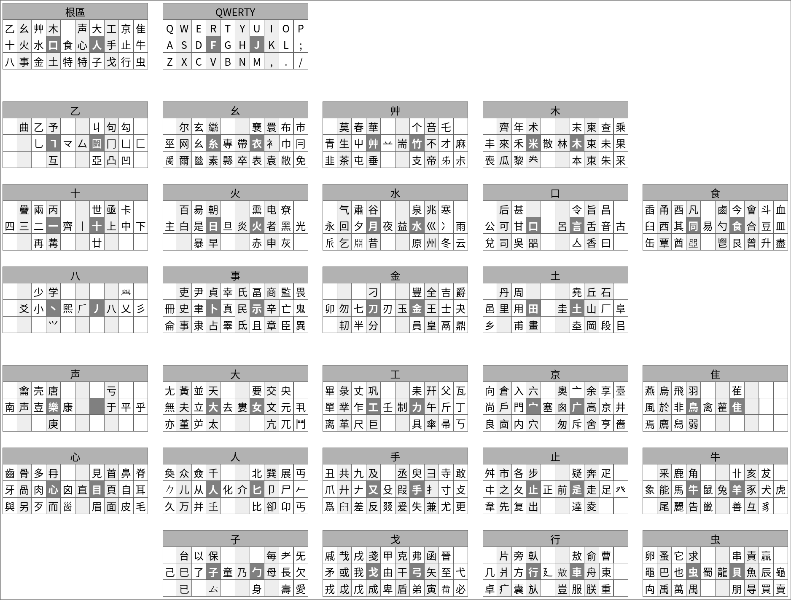

# 原碼

[Rime](https://rime.im/) 思源形義輸入法

又名原碼

## 字根圖

## 字根變躰

<table>
	<tr>
		<td>僉佥㑒</td>
		<td>奐奂</td>
		<td>無无</td>
		<td>婁娄</td>
		<td>長镸长</td>
		<td>壽寿</td>
		<td>愛爱</td>
		<td>言讠</td>
	</tr>
	<tr>
		<td>吳吴呉</td>
		<td>爲為为</td>
		<td>韋韦</td>
		<td>達达</td>
		<td>見见</td>
		<td>頁页</td>
		<td>齒齿歯</td>
		<td>與与</td>
	</tr>
	<tr>
		<td>腦脑脳</td>
		<td>馬马</td>
		<td>麗丽</td>
		<td>貝贝</td>
		<td>贏赢</td>
		<td>龍龙</td>
		<td>龜龟亀</td>
		<td>黽黾㫣</td>
	</tr>
	<tr>
		<td>鳥鸟</td>
		<td>烏乌</td>
		<td>風风</td>
		<td>飛飞</td>
		<td>雚𮥶</td>
		<td>金钅</td>
		<td>乘乗</td>
		<td>柬𫠣</td>
	</tr>
	<tr>
		<td>來来</td>
		<td>豐豊</td>
		<td>齊齐斉</td>
		<td>肅肃粛</td>
		<td>昜汤</td>
		<td>堯尧</td>
		<td>岡冈</td>
		<td>畫画</td>
	</tr>
	<tr>
		<td>食饣</td>
		<td>會会</td>
		<td>盡尽</td>
		<td>鹵卤</td>
		<td>華华</td>
		<td>糸纟</td>
		<td>巠𢀖</td>
		<td>專专専</td>
	</tr>
	<tr>
		<td>縣县県</td>
		<td>帶带帯</td>
		<td>侖仑</td>
		<td>貞贞</td>
		<td>監监</td>
		<td>睪𠬤</td>
		<td>單单単</td>
		<td>畢毕</td>
	</tr>
	<tr>
		<td>彔录</td>
		<td>傘伞</td>
		<td>戔戋</td>
		<td>晉晋</td>
		<td>門门</td>
		<td>戶户戸</td>
		<td>倉仓</td>
		<td>舍舎</td>
	</tr>
	<tr>
        <td>奧奥</td>
		<td>車车</td>
		<td>東东</td>
		<td>爿丬</td>
		<td>兩两両</td>
		<td>亞亚亜</td>
		<td>樂乐楽</td>
		<td>冫氷</td>
	</tr>
</table>

<table>
	<tr>
		<td>人亻</td>
		<td>众𫡑乑</td>
		<td>堇𦰩</td>
		<td>母毋</td>
		<td>耂老</td>
		<td>兌兑</td>
		<td>呂吕</td>
		<td>攴攵</td>
	</tr>
	<tr>
		<td>辵辶</td>
		<td>心忄㣺</td>
        <td>肉𱼀⺼</td>
        <td>歹歺</td>
		<td>犬犭</td>
		<td>刀刂</td>
		<td>水氵</td>
		<td>巛川𫶧</td>
    </tr>
    <tr>
		<td>火灬</td>
        <td>冉冄</td>
        <td>插挿</td>
        <td>艸艹</td>
        <td>竹𥫗</td>
        <td>青靑</td>
        <td>个亇</td>
        <td>衣𠅃</td>
    </tr>
	<tr>
        <td>敝㡀</td>
		<td>冊册</td>
		<td>亡亾</td>
		<td>示礻</td>
		<td>真眞</td>
		<td>丵業业</td>
		<td>行彳</td>
		<td>倝𠦝</td>
	</tr>
    <tr>
		<td>八丷</td>
		<td>冂冖</td>
    </tr>
</table>

## 同碼字根

<table>
	<tr>
		<td>丮·丸</td>
		<td>串·毌</td>
		<td>𠂤·㠯</td>
		<td>艮·皀</td>
		<td>屮·卉</td>
		<td>衤·𧘇</td>
		<td>几·丌</td>
		<td>匚·匸</td>
		<td>开·幵</td>
	</tr>
</table>

## 配字

可組字
<table>
	<tr>
		<td>㗊（器）</td>
		<td>亼（命）</td>
		<td>𠂇（有）</td>
		<td>扌（承）</td>
		<td>卝（芈）</td>
	</tr>
	<tr>
		<td>彑（彙）</td>
		<td>𦥑（興兴）</td>
		<td>癶（發发）</td>
		<td>䒑（着）</td>
	</tr>
</table>

不可組字
<table>
	<tr>
		<td>疊〔品〕</td>
		<td>辵〔退〕</td>
		<td>冫〔冰〕</td>
		<td>疒〔病〕</td>
	</tr>
</table>

## 拆字規則

<table>
  <tr>
    <td>舞</td><td>無舛</td><td></td>
    <td>爽</td><td>大爻爻</td><td></td>
    <td>丟</td><td>一去</td><td></td>
    <td>丢</td><td>丿去</td>
  </tr>
  <tr>
    <td>兵</td><td>斤廾</td><td></td>
    <td>典</td><td>冊廾</td><td></td>
    <td>印</td><td>爪卩</td><td></td>
    <td>虐</td><td>虎爪</td>
  </tr>
  <tr>
    <td>貴</td><td>臾貝</td><td></td>
    <td>遣</td><td>辵臾㠯</td><td></td>
    <td>祭</td><td>肉又示</td><td></td>
    <td>蚩</td><td>之虫</td>
  </tr>
  <tr>
    <td>憂</td><td>頁心夊</td><td></td>
    <td>德</td><td>行直心</td><td></td>
    <td>徳</td><td>行直心</td><td></td>
    <td>那</td><td>冄邑</td>
  </tr>
  <tr>
    <td>衰</td><td>衣冄</td><td></td>
    <td>慶</td><td>鹿心夊</td><td></td>
    <td>犀</td><td>尾牛</td><td></td>
    <td>屬</td><td>尾蜀</td>
  </tr>
  <tr>
    <td>巤</td><td>𡿺鼠</td><td></td>
	<td>留</td><td>卯田</td><td></td>
    <td>劉</td><td>卯金刀</td><td></td>
	<td>齋</td><td>齊示</td>
  </tr>
  <tr>
    <td>斎</td><td>齊示</td><td></td>
    <td>桼</td><td>木黎</td><td></td>
    <td>黍</td><td>禾黎</td><td></td>
	<td>虛</td><td>虎丘</td>
  </tr>
  <tr>
    <td>在</td><td>才土</td><td></td>
    <td>存</td><td>才子</td><td></td>
    <td>啇</td><td>帝口</td><td></td>
	<td>丝</td><td>糸糸</td>
  </tr>
  <tr>
    <td>惠</td><td>專心</td><td></td>
    <td>恵</td><td>專心</td><td></td>
    <td>冡</td><td>冃豕</td><td></td>
	<td>爭</td><td>爪尹</td>
  </tr>
  <tr>
    <td>争</td><td>⺈尹</td><td></td>
	<td>覽</td><td>監見</td><td></td>
	<td>览</td><td>監見</td><td></td>
	<td>临</td><td>監口</td>
  </tr>
  <tr>
	<td>曷</td><td>日勹亡</td><td></td>
    <td>對</td><td>丵一寸</td><td></td>
	<td>叢</td><td>丵耳又</td><td></td>
	<td>菐</td><td>丵廾</td>
  </tr>
  <tr>
	<td>算</td><td>竹具</td><td></td>
    <td>戍</td><td>戈人</td><td></td>
    <td>臧</td><td>戈爿臣</td><td></td>
	<td>雋</td><td>隹弓</td>
  </tr>
  <tr>
	<td>第</td><td>竹弟</td><td></td>
    <td>啚</td><td>口㐭</td><td></td>
    <td>容</td><td>穴公</td><td></td>
	<td>旅</td><td>㫃从</td>
  </tr>
  <tr>
	<td>乾</td><td>倝乙</td><td></td>
    <td>桌</td><td>卓木</td><td></td>
    <td>㒼</td><td>廿兩</td><td></td>
	<td>噩</td><td>王㗊</td>
  </tr>
  <tr>
	<td>喬</td><td>丿大高</td><td></td>
	<td>虱</td><td>飛虫</td>
  </tr>
</table>

<table>
	<tr>
		<td>囂嘂等</td><td>㗊＊</td>
		<td></td>
		<td>船沿等</td><td>＊公</td>
		<td></td>
		<td>嬴羸等</td><td>贏＊</td>
	</tr>
	<tr>
		<td>豪亭等</td><td>高＊</td>
		<td></td>
		<td>衷裏等</td><td>衣＊</td>
		<td></td>
		<td>纂篡等</td><td>竹具＊</td>
	</tr>
	<tr>
		<td>威咸等</td><td>戌＊</td>
		<td></td>
		<td>街術等</td><td>行＊</td>
		<td></td>
		<td>族施等</td><td>㫃＊</td>
	</tr>
	<tr>
		<td>幹斡等</td><td>倝＊</td>
		<td></td>
		<td>勝騰等</td><td>朕＊</td>
		<td></td>
		<td>黴徽等</td><td>行𢼸＊</td>
	</tr>
    <tr>
		<td>希肴等</td><td>爻＊</td>
		<td></td>
        <td>森淼等</td><td>疊＊</td>
    </tr>
</table>

<table>
	<tr>
		<td>
			阝在左則爲阜、在右則爲邑。
		</td>
		<td>
			陳、阜東。 
			都、者邑。
		</td>
	</tr>
	<tr>
		<td>
			𡨄既屬於寒、也屬於塞。 
			因此、帶𡨄的字有兩種拆法。
		</td>
		<td>
			賽、寒貝。騫、寒馬。 
			賽、塞貝。騫、塞馬。
		</td>
	</tr>
	<tr>
		<td>
			「熙」是特殊字根、用於輸入康熙部首。
		</td>
		<td>
			⾋（康熙部首）、熙艸。
		</td>
	</tr>
</table>

## 鍵位碼

|小|无|中|食|||食|中|无|小|
|:-:|:-:|:-:|:-:|:-:|:-:|:-:|:-:|:-:|:-:|
|Q ㈠|W ㈡|E ㈢|R ㈣|T ㈤|Y ㈥|U ㈦|I ㈧|O ㈨|P ㈩|
|A ㊀|S ㊁|D ㊂|F ㊃|G ㊄|H ㊅|J ㊆|K ㊇|L ㊈|; ㊉|
|Z ①|X ②|C ③|V ④|B ⑤|N ⑥|M ⑦|, ⑧|. ⑨|/ ⑩|

## 編碼規則

### 字碼

「=」代表特殊鍵。

|根數|取碼法|例子|
|:-:|:-:|:-:|
|一根|Aa|爲=手① 爲：手①。為：手①。为：手①。|
|二根|AaBb|宀=京㊃。豕=牛㊇。 家：京㊃牛㊇|
|三根|AaBC=|木=木㊆。目=心㊂。心=心㊃。 想：木㊆心心特|
|四根|ABCD=|應：京人隹心特|
|四根以上|ABYZ=|機：木幺戈人特|

### 詞碼

單根字的組詞碼是「Aaa」、比如方的組詞碼就是「行㊂㊂」。

|字數|取碼法|例子|
|:-:|:-:|:-:|
|二字|AaAcBaBc|規律：大心行事 方案：行㊂京大|
|三字|AaBaBcCaCc|不知道：艸戈口止心 對不起：工艸㊇止子|
|四字|AaBaCaDaDc|飲水思源：食水心水水 似水流年：人水水木㈣|
|四字以上|AaBaCaDaEa|中華人民共和國：十艸人事手 一氧化二氫：十水人十水|

## 簡碼

簡碼全部依據字頻自動生成。

重碼時、最常用的一个字保留編碼、其餘的字換下一个取碼法再試一次。

### 一簡

根數要求：一根以上

取碼法：A（如果根區鍵是標點鍵、則還需再按一下特殊鍵）

<table>
	<tr>
		<th colspan="10">繁</th>
	</tr>
	<tr align="center">
		<td>乙 （國）</td><td>幺 （經）</td><td>艸 （在）</td><td>木 （樣）</td><td></td>
		<td>声 （聲）</td><td>大 （好）</td><td>工 （對）</td><td>京 （家）</td><td>隹 （觀）</td>
	</tr>
	<tr align="center">
		<td>十 （資）</td><td>火 （的）</td><td>水 （外）</td><td>口 （說）</td><td>食 （兒）</td>
		<td>心 （然）</td><td>人 （們）</td><td>手 （看）</td><td>止 （這）</td><td>牛 （美）</td>
	</tr>
	<tr align="center">
		<td>八 （學）</td><td>事 （望）</td><td>金 （現）</td><td>土 （地）</td><td></td>
		<td></td><td>子 （孩）</td><td>到 （戈）</td><td>行 （得）</td><td>虫 （則）</td>
	</tr>
</table>

<table>
	<tr>
		<th colspan="10">简</th>
	</tr>
	<tr align="center">
		<td>乙 （国）</td><td>幺 （经）</td><td>艸 （在）</td><td>木 （和）</td><td></td>
		<td>声 （喜）</td><td>大 （她）</td><td>工 （怎）</td><td>京 （就）</td><td>隹 （集）</td>
	</tr>
	<tr align="center">
		<td>十 （紧）</td><td>火 （的）</td><td>水 （没）</td><td>口 （说）</td><td>食 （斯）</td>
		<td>心 （那）</td><td>人 （他）</td><td>手 （看）</td><td>止 （这）</td><td>牛 （美）</td>
	</tr>
	<tr align="center">
		<td>八 （么）</td><td>事 （点）</td><td>金 （现）</td><td>土 （地）</td><td></td>
		<td></td><td>子 （孩）</td><td>到 （戈）</td><td>行 （得）</td><td>虫 （则）</td>
	</tr>
</table>

### 二簡

根數要求：双根

取碼法：
|1|2|3|
|:-:|:-:|:-:|
|AB=|ABb=|AaB=|

### 三簡

根數要求：二根以上

取碼法：
|1|2|3|4|5|6|7|
|:-:|:-:|:-:|:-:|:-:|:-:|:-:|
|ABC|ABZ|AYZ|AaB|AaZ|ABb|AZz|
